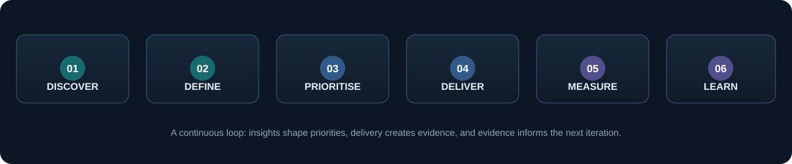

  
  
  

### Product thinking. Technical understanding. Measurable delivery.

**Product Owner · Product Business Analyst · Technical Business Analyst**

[Explore projects](https://github.com/NithinRavindran?tab=repositories) &nbsp;·&nbsp;
[Corporate Travel Platform](https://github.com/NithinRavindran/Corporate-Travel-Platform) &nbsp;·&nbsp;
[GitHub profile](https://github.com/NithinRavindran)

---

## 01 — Profile

I’m a product-focused professional with **4+ years of experience** across **Healthcare Systems, B2B & B2C Travel Technology, Corporate Travel Management, and Vulnerability & Incident Management**.

I work between business stakeholders and technical teams: understanding user and operational problems, translating them into clear requirements, prioritising work, supporting engineering delivery, validating outcomes and coordinating releases.

My experience spans clinical and laboratory workflows, travel booking and supplier integrations, corporate travel policies and approvals, and security incident lifecycle management.

**What I bring:** cross-domain product understanding, structured business analysis, technical fluency and a focus on delivery outcomes.

## 02 — Experience at a glance

<table>
  <tr>
    <td align="center" width="25%">
      <h1>4+</h1>
      <strong>Years</strong> 
      Product & business analysis
    </td>
    <td align="center" width="25%">
      <h1>4</h1>
      <strong>Product domains</strong> 
      Healthcare, travel and security
    </td>
    <td align="center" width="25%">
      <h1>10+</h1>
      <strong>Hospitals</strong> 
      HIMS implementations
    </td>
    <td align="center" width="25%">
      <h1>3,000+</h1>
      <strong>Infrastructure nodes</strong> 
      Vulnerability scanning scope
    </td>
  </tr>
</table>

## 03 — Product domain experience

Four distinct product environments. Different users and business goals, with a common focus on workflow clarity, system reliability and measurable outcomes.

### 01. Healthcare Systems

**HIMS · EHR / EMR · LIS · Laboratory Device Interfacing**

Hospital and laboratory platforms supporting patient administration, clinical workflows and diagnostic operations.

**Product scope**
- Patient registration, scheduling and appointment workflows
- Electronic Health Records (EHR) and Electronic Medical Records (EMR)
- Pharmacy, inventory and Laboratory Information System (LIS)
- Laboratory device interfacing and result exchange
- Data validation, UAT, release coordination and stabilisation

**Reported delivery outcomes**

| Measure | Result |
|---|---:|
| Hospital implementations | **10+** |
| Production releases | **15+** |
| Post-deployment defects | **30% reduction** |
| Sprint velocity | **20% improvement** |
| First-pass UAT acceptance | **92%** |

*Product focus: clinical workflow accuracy, data integrity, interoperability and reliable hospital operations.*

---

### 02. B2B & B2C Travel Technology

**Travel booking · Booking engine · Supplier integrations**

Travel technology serving both business partners and end customers through online and agent-assisted booking journeys.

**Product scope**
- B2C flight, hotel and travel booking experiences
- B2B partner, agent and distribution workflows
- Flights, hotels, transfers, activities and packages
- GDS, airline, Low-Cost Carrier (LCC) and NDC integrations
- Search, pricing, availability, booking, cancellation and servicing

**Reported product and delivery outcomes**

| Measure | Result |
|---|---:|
| Booking success | **~15% improvement** |
| Booking drop-offs | **10–12% reduction** |
| Delivery efficiency | **25–30% improvement** |
| Rework | **~30% reduction** |

*Product focus: booking conversion, supplier connectivity, transaction reliability and end-to-end traveller experience.*

---

### 03. Corporate Travel Management

**Managed business travel · Policy · Approvals · Spend**

Corporate travel workflows that help organisations manage employee travel, enforce policy and improve visibility into travel spend.

**Product scope**
- Employee travel requests and booking workflows
- Travel policy rules, approval hierarchies and exceptions
- Multi-city and international itineraries
- Mobile trip management and itinerary visibility
- Spend forecasting, policy insights and reporting
- Changes, cancellations and post-booking support

**Product measures I would track**
- Policy-compliant booking rate
- Approval turnaround time
- Online booking adoption
- Average trip cost and spend variance
- Booking completion and change/cancellation rate

*Product focus: traveller experience, policy compliance, approval efficiency and spend visibility.*

[**Explore the Corporate Travel Platform repository →**](https://github.com/NithinRavindran/Corporate-Travel-Platform)

---

### 04. Vulnerability & Incident Management

**Security operations · Scanner orchestration · Incident lifecycle**

Security product workflows that connect infrastructure vulnerabilities and SIEM alerts with actionable incident response.

**Product scope**
- Vulnerability scanner orchestration across infrastructure
- Findings, severity and prioritisation workflows
- SIEM alert-to-incident correlation
- Incident lifecycle, ownership and resolution states
- Dashboards for MTTR, incident trends and SLA compliance

**Reported scale and outcomes**

| Measure | Result |
|---|---:|
| Infrastructure scanning scope | **3,000+ nodes** |
| Mean Time to Resolution (MTTR) | **35% reduction** |
| Alert-to-actionable-incident conversion | **20% → 75%** |

*Product focus: actionable findings, response time, incident resolution and SLA performance.*

## 04 — Selected product outcomes

A consolidated view of the project-level results above. Metrics reflect reported outcomes from the relevant projects and teams, not individual attribution in isolation.

<table>
  <tr>
    <th align="left">Domain</th>
    <th align="left">Outcome</th>
    <th align="left">Reported result</th>
  </tr>
  <tr>
    <td>Healthcare</td>
    <td>Post-deployment defect reduction</td>
    <td><strong>30%</strong></td>
  </tr>
  <tr>
    <td>Healthcare</td>
    <td>First-pass UAT acceptance</td>
    <td><strong>92%</strong></td>
  </tr>
  <tr>
    <td>B2B & B2C Travel</td>
    <td>Booking success improvement</td>
    <td><strong>~15%</strong></td>
  </tr>
  <tr>
    <td>B2B & B2C Travel</td>
    <td>Booking drop-off reduction</td>
    <td><strong>10–12%</strong></td>
  </tr>
  <tr>
    <td>Travel delivery</td>
    <td>Delivery efficiency improvement</td>
    <td><strong>25–30%</strong></td>
  </tr>
  <tr>
    <td>Vulnerability & Incident Management</td>
    <td>MTTR reduction</td>
    <td><strong>35%</strong></td>
  </tr>
  <tr>
    <td>Vulnerability & Incident Management</td>
    <td>Actionable incident conversion</td>
    <td><strong>20% → 75%</strong></td>
  </tr>
</table>

## 05 — Product ownership capabilities

<table>
  <tr>
    <td width="50%" valign="top">
      <h3>Discovery & strategy</h3>
      <ul>
        <li>Stakeholder and user discussions</li>
        <li>Problem definition and workflow analysis</li>
        <li>Business value and impact assessment</li>
        <li>Product scope and MVP definition</li>
        <li>Roadmap and release planning input</li>
      </ul>
    </td>
    <td width="50%" valign="top">
      <h3>Requirements & prioritisation</h3>
      <ul>
        <li>BRD, FRD and PRD documentation</li>
        <li>Epics, user stories and acceptance criteria</li>
        <li>Backlog refinement and prioritisation</li>
        <li>Business rules and process modelling</li>
        <li>Dependencies, traceability and change control</li>
      </ul>
    </td>
  </tr>
  <tr>
    <td width="50%" valign="top">
      <h3>Delivery & collaboration</h3>
      <ul>
        <li>Engineering, QA and design coordination</li>
        <li>Agile and Scrum ceremonies</li>
        <li>Scope, risk and dependency management</li>
        <li>UAT planning and stakeholder sign-off</li>
        <li>Release readiness and go-live support</li>
      </ul>
    </td>
    <td width="50%" valign="top">
      <h3>Quality & product improvement</h3>
      <ul>
        <li>End-to-end and edge-case validation</li>
        <li>API and integration testing support</li>
        <li>Defect triage and resolution follow-up</li>
        <li>Post-release feedback and stabilisation</li>
        <li>KPI tracking and continuous improvement</li>
      </ul>
    </td>
  </tr>
</table>

## 06 — Technical fluency

I use technical understanding to clarify requirements, assess dependencies and collaborate effectively with engineering teams.

**Product & delivery**
 

**Application & backend technologies**
 

**APIs, data & integration**
 

**Domain technologies & concepts**
 
- Healthcare: HIMS, EHR / EMR, LIS, laboratory device interfacing
- Travel: GDS, airline integrations, LCC, NDC, booking engines
- Security: vulnerability scanning, SIEM correlation, incident lifecycle

## 07 — Product delivery approach

| Stage | Main question | Typical output |
|---|---|---|
| Discover | What problem are we solving? | User needs, problem statement |
| Define | What should the product do? | Scope, requirements, acceptance criteria |
| Prioritise | What matters most now? | Prioritised backlog, trade-offs |
| Deliver | How do we validate and release it? | QA, UAT, release readiness |
| Measure | Did it achieve the intended outcome? | KPIs, feedback, product insights |
| Improve | What should happen next? | Iteration and roadmap input |

## 08 — Current learning focus

Building deeper capability in the areas that connect product decisions with customer and business outcomes.

- **Product analytics:** funnels, adoption, retention, conversion and experimentation
- **AI product management:** LLM foundations, prompt design, evaluation and responsible AI use cases
- **Technical product ownership:** APIs, integrations, architecture fundamentals and data flows
- **Product strategy:** discovery, prioritisation, MVP thinking and outcome-based roadmaps

## 09 — Let's connect

I’m interested in **Product Owner, Product Analyst and Associate Product Manager** opportunities where I can bring together cross-domain product experience, business analysis and technical understanding.

  
Healthcare · B2B & B2C Travel · Corporate Travel · Vulnerability & Incident Management

---

Portfolio note: This page summarises professional domain experience and selected portfolio work. The Corporate Travel Platform link is a portfolio repository; other domain descriptions summarise experience and do not imply that employer-owned systems or confidential source code are public. Metrics are reported project-level outcomes and should be explained in their original context.
