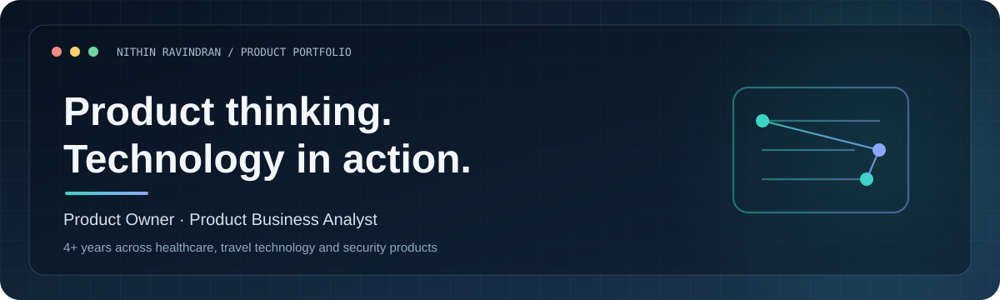

<!--
  Nithin Ravindran | Product & Technology Portfolio
  Keep this README focused on real experience, product thinking, and demonstrable work.
-->

  
   
  
<strong>PRODUCT OWNERSHIP · BUSINESS ANALYSIS · TECHNOLOGY DELIVERY</strong>

  

    <a href="https://github.com/NithinRavindran">GitHub Profile</a>
    &nbsp;·&nbsp;
    <a href="https://github.com/NithinRavindran/Corporate-Travel-Platform">Corporate Travel Platform</a>
  

---

## About

I am a Product Owner and Technical Business Analyst with 4+ years of experience working across healthcare systems, travel technology, corporate travel, and vulnerability management.

I enjoy getting close to the problem: speaking with users and stakeholders, understanding how a process works, identifying gaps, and helping engineering teams turn requirements into features that can be tested and released.

My work sits between business and technology. I contribute to discovery, requirements, prioritisation, backlog management, integrations, UAT, and release coordination.

## Product experience

<table>
  <tr>
    <td width="50%" valign="top">
      <h3>01 · Corporate travel</h3>
      
<strong>Travel management platform</strong>

      
Product workflows for business travel, from search and booking through approvals and trip management.

      <ul>
        <li>Flights, hotels, transfers and booking flows</li>
        <li>Multi-city and international travel scenarios</li>
        <li>Travel policies, approvals and cancellations</li>
        <li>Mobile trip management</li>
        <li>Spend forecasting and policy insights</li>
      </ul>
      <a href="https://github.com/NithinRavindran/Corporate-Travel-Platform">Explore the repository →</a>
    </td>
    <td width="50%" valign="top">
      <h3>02 · Vulnerability management</h3>
      
<strong>Security operations and incident workflows</strong>

      
Product work around turning scanner findings and security alerts into trackable incidents.

      <ul>
        <li>Scanner orchestration and findings</li>
        <li>Alert-to-incident correlation</li>
        <li>Incident lifecycle and status transitions</li>
        <li>SLA, MTTR and incident analytics</li>
      </ul>
      
<em>Experience case study — product details can be discussed in an interview.</em>

    </td>
  </tr>
  <tr>
    <td width="50%" valign="top">
      <h3>03 · Healthcare systems</h3>
      
<strong>Hospital Information System (HIS / HIMS)</strong>

      
Work across hospital workflows where accuracy, traceability and reliable integrations matter.

      <ul>
        <li>Patient scheduling and clinical workflows</li>
        <li>EMR, pharmacy and inventory</li>
        <li>Laboratory Information System workflows</li>
        <li>Laboratory device integrations and data flow</li>
      </ul>
      
<em>Experience case study — no patient or confidential implementation data is included.</em>

    </td>
    <td width="50%" valign="top">
      <h3>04 · AI-enabled travel</h3>
      
<strong>Travel assistant product workflows</strong>

      
Interest and product work around applying AI to travel discovery, assistance and customer journeys.

      <ul>
        <li>Travel user journeys and support scenarios</li>
        <li>Understanding user intent and response quality</li>
        <li>Requirements for useful AI-assisted experiences</li>
        <li>Balancing user experience with operational needs</li>
      </ul>
      
<em>Product focus — not presented as a standalone shipped AI platform.</em>

    </td>
  </tr>
</table>

## How I work as a Product Owner

| Area | What I focus on |
|---|---|
| Discovery | Understand user problems, business goals and current workflows |
| Requirements | Turn discussions into clear functional requirements and user stories |
| Prioritisation | Weigh customer impact, business value, effort, risk and dependencies |
| Backlog | Keep stories, acceptance criteria and priorities clear for delivery |
| Collaboration | Work with engineering, QA, design, operations and business teams |
| Quality | Review scenarios, edge cases, integrations and UAT feedback |
| Release | Coordinate readiness, sign-off, go-live and post-release follow-up |
| Improvement | Use feedback and product measures to identify what should change next |

## Technical understanding

I work comfortably with technical teams and use technical knowledge to make requirements clearer and delivery smoother.

- **API & integration:** REST APIs, JSON, Postman, Swagger
- **Data:** SQL, PostgreSQL, data validation and reporting concepts
- **Application technologies:** Angular, Node.js, NestJS
- **Product & delivery tools:** Jira, Confluence, Figma, Lucidchart, Excel
- **Ways of working:** Agile, Scrum, backlog refinement, UAT and release management

## Product analytics & AI — areas I am developing

I am building further depth in using product data to understand behaviour and outcomes, including:

- Product KPIs, funnels, adoption and feature usage
- Conversion, drop-off and workflow performance
- Using evidence to support prioritisation
- LLM fundamentals, prompt design and AI product use cases
- AI-assisted workflows, evaluation and responsible product decisions

## Featured work

- **[Corporate Travel Platform](https://github.com/NithinRavindran/Corporate-Travel-Platform)** — product scope, workflows and feature documentation for a corporate travel platform.
- **[More repositories](https://github.com/NithinRavindran?tab=repositories)** — additional technical and learning work.

## Let's connect

I am interested in Product Owner, Product Analyst and product-focused Business Analyst opportunities where I can work closely with users and engineering teams to deliver useful, reliable products.

  <a href="https://github.com/NithinRavindran">github.com/NithinRavindran</a>

---

Built as a working portfolio. Project descriptions focus on product scope and experience; confidential employer, customer and implementation information is intentionally excluded.
